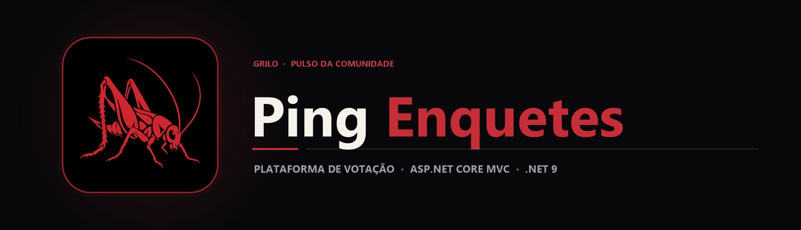

  

  Plataforma web interativa para criação, gerenciamento e votação em enquetes construída com C# e ASP.NET Core MVC (.NET 9).

  
  
  

## Sobre o projeto

O **Ping Enquetes** é uma aplicação web em **ASP.NET Core MVC (.NET 9)** projetada para tornar a coleta de opiniões e votações rápida e acessível, sem exigir a configuração pesada de um servidor de banco de dados externo para rodar.

A arquitetura utiliza uma camada de serviços dedicada (PollRepository e SessionDataService) que persiste enquetes e usuários de forma estruturada em arquivos JSON (Data/polls.json e Data/users.json), garantindo portabilidade imediata e execução leve em qualquer ambiente com SDK .NET.

## Principais recursos

| Recurso | Como funciona |
|---|---|
| Criação e gestão de enquetes | EnqueteController permite criar perguntas com múltiplas opções (Criar.cshtml), acompanhar votos (Detalhes.cshtml) e administrar enquetes ativas (Gerenciar.cshtml). |
| Autenticação de contas | AccountController gerencia o fluxo de login e cadastro de usuários com sessão ativa via SessionDataService. |
| Persistência JSON autocontida | PollRepository lê e grava os dados diretamente em Data/polls.json e Data/users.json. |
| Interface Razor responsiva | Telas organizadas por contexto (Account, Enquete, Home) com atualização imediata dos percentuais de votação. |

## Tecnologias

  
  
  
  
  

- **C# e ASP.NET Core (.NET 9)** no back-end e nos controladores MVC;
- **Serviços injetados (PollRepository, SessionDataService)** para manipulação de estado e armazenamento;
- **Razor Views (.cshtml)** para renderização das páginas de votação e painel.

## Arquitetura

`mermaid
flowchart LR
    A[Usuário / Navegador] --> B[EnqueteController & AccountController]
    B --> C[SessionDataService · Sessão Ativa]
    B --> D[PollRepository · Camada de Dados]
    D <--> E[(Data/polls.json & users.json)]
`

## Estrutura do repositório

`	ext
Ping-Enquetes/
├── assets/
│   ├── banner.png                          Banner principal Ping Enquetes
│   └── project-animal.png                  Símbolo do grilo
├── WebApplication1/
│   ├── Controllers/                        AccountController, EnqueteController e HomeController
│   ├── Data/                               polls.json e users.json (persistência local)
│   ├── Models/                             Poll.cs, User.cs e ErrorViewModel.cs
│   ├── Services/                           PollRepository.cs e SessionDataService.cs
│   ├── Views/                              Telas Razor (Account, Enquete, Home, Shared)
│   └── Program.cs                          Injeção de dependências e pipeline HTTP
├── WebApplication1.sln                     Solução Visual Studio
└── README.md
`

## Executando o código

1. Clone o repositório:
   `powershell
   git clone https://github.com/arthurlynow098/Ping-Enquetes.git
   cd Ping-Enquetes
   `
2. Execute a aplicação diretamente com o SDK .NET 9:
   `powershell
   dotnet run --project WebApplication1/WebApplication1.csproj
   `
3. Abra o endereço local exibido no terminal (ex.: http://localhost:5000) para criar e votar em enquetes imediatamente.

## Decisões técnicas

- **Repositório em JSON (PollRepository):** permite clonar e executar o projeto instantaneamente sem depender de provisionamento prévio de banco de dados SQL.

---

Estudo · construção · evolução <a href="https://github.com/arthurlynow098">Perfil</a> · <a href="https://arthurentsev.vercel.app/">Portfólio</a> · <a href="https://www.linkedin.com/in/entsevarthur/">LinkedIn</a>

