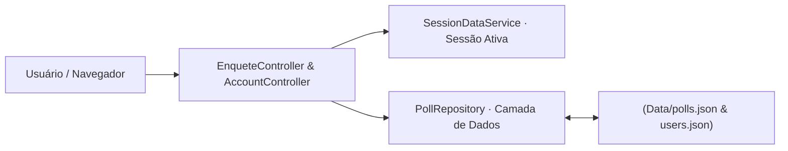

<p align="center">
  
</p>

<p align="center">Criação e votação em enquetes com persistência em JSON e controle de sessão.</p>


<p align="center"><a href="#visão-geral">Visão geral</a> &nbsp;·&nbsp; <a href="#recursos">Recursos</a> &nbsp;·&nbsp; <a href="#como-executar">Como executar</a></p>

<p align="center"></p>

<a id="explore-o-projeto"></a>

## Por onde começar


- **[Enquetes](WebApplication1/Controllers/EnqueteController.cs)** — Ações de criação e consulta de enquetes.
- **[Persistência](WebApplication1/Services/PollRepository.cs)** — Acesso aos dados de enquetes.
- **[Telas](WebApplication1/Views/Enquete)** — Páginas Razor de interação com as enquetes.


<a id="visão-geral"></a>

## Visão geral

A arquitetura utiliza uma camada de serviços dedicada (PollRepository e SessionDataService) que persiste enquetes e usuários de forma estruturada em arquivos JSON (Data/polls.json e Data/users.json), garantindo portabilidade imediata e execução leve em qualquer ambiente com SDK .NET.

<a id="recursos"></a>

## Recursos

**Criação e gestão de enquetes**<br>
EnqueteController permite criar perguntas com múltiplas opções (Criar.cshtml), acompanhar votos (Detalhes.cshtml) e administrar enquetes ativas (Gerenciar.cshtml).

**Autenticação de contas**<br>
AccountController gerencia o fluxo de login e cadastro de usuários com sessão ativa via SessionDataService.

**Persistência JSON autocontida**<br>
PollRepository lê e grava os dados diretamente em Data/polls.json e Data/users.json.

**Interface Razor responsiva**<br>
Telas organizadas por contexto (Account, Enquete, Home) com atualização imediata dos percentuais de votação.

<a id="tecnologias"></a>

## Tecnologias

- **C# e ASP.NET Core (.NET 9)** no back-end e nos controladores MVC;
- **Serviços injetados (PollRepository, SessionDataService)** para manipulação de estado e armazenamento;
- **Razor Views (.cshtml)** para renderização das páginas de votação e painel.

<details>
<summary>Arquitetura</summary>



</details>

<details>
<summary>Estrutura do repositório</summary>

```text
Ping-Enquetes/
├── assets/
│   └── identity/banner.png               Banner do projeto
├── WebApplication1/
│   ├── Controllers/                        AccountController, EnqueteController e HomeController
│   ├── Data/                               polls.json e users.json (persistência local)
│   ├── Models/                             Poll.cs, User.cs e ErrorViewModel.cs
│   ├── Services/                           PollRepository.cs e SessionDataService.cs
│   ├── Views/                              Telas Razor (Account, Enquete, Home, Shared)
│   └── Program.cs                          Injeção de dependências e pipeline HTTP
├── WebApplication1.sln                     Solução Visual Studio
└── README.md
```

</details>

<a id="como-executar"></a>

## Como executar

1. Clone o repositório:
   ```powershell
   git clone https://github.com/arthurlynow098/Ping-Enquetes.git
   cd Ping-Enquetes
   ```
2. Execute a aplicação diretamente com o SDK .NET 9:
   ```powershell
   dotnet run --project WebApplication1/WebApplication1.csproj
   ```
3. Abra o endereço local exibido no terminal (ex.: http://localhost:5000) para criar e votar em enquetes imediatamente.

<a id="decisões-técnicas"></a>

## Decisões técnicas

- **Repositório em JSON (PollRepository):** permite clonar e executar o projeto instantaneamente sem depender de provisionamento prévio de banco de dados SQL.

<p align="center"></p>

<p align="center">
  <a href="https://github.com/arthurlynow098">GitHub</a> &nbsp;·&nbsp;
  <a href="https://arthurentsev.vercel.app/">Portfólio</a> &nbsp;·&nbsp;
  <a href="https://www.linkedin.com/in/entsevarthur/">LinkedIn</a>
</p>
